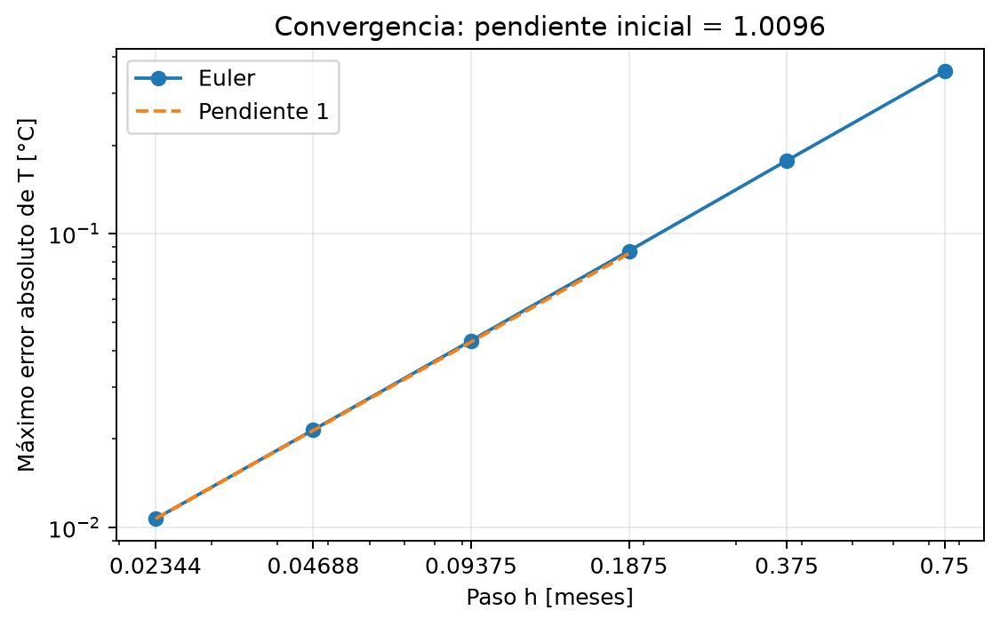
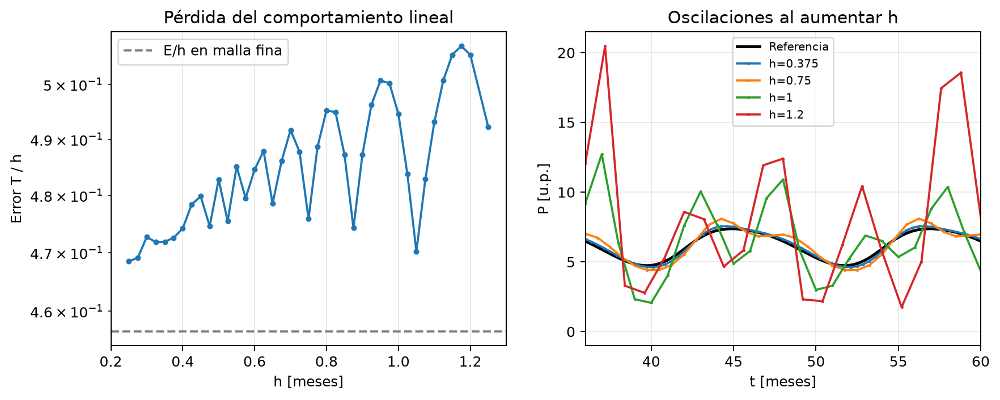
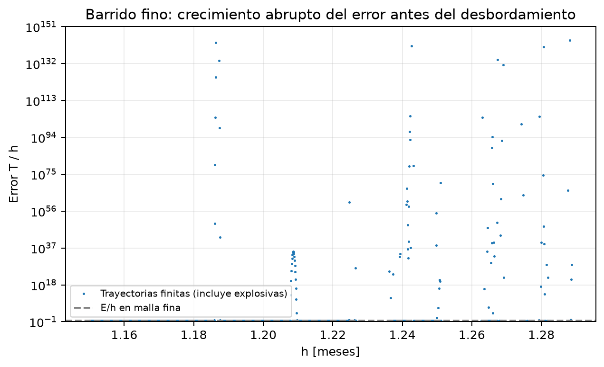
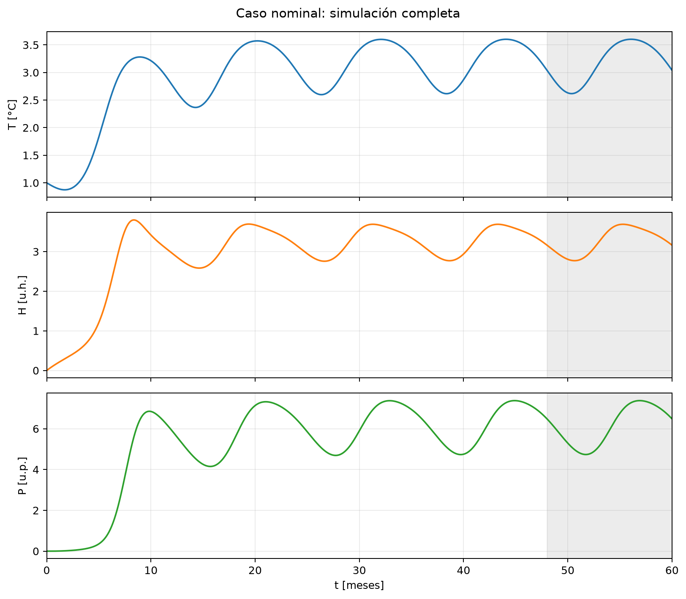
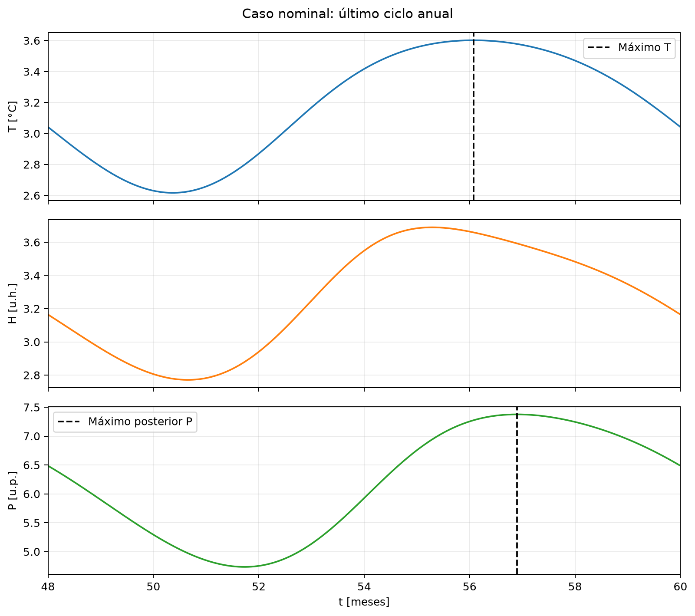
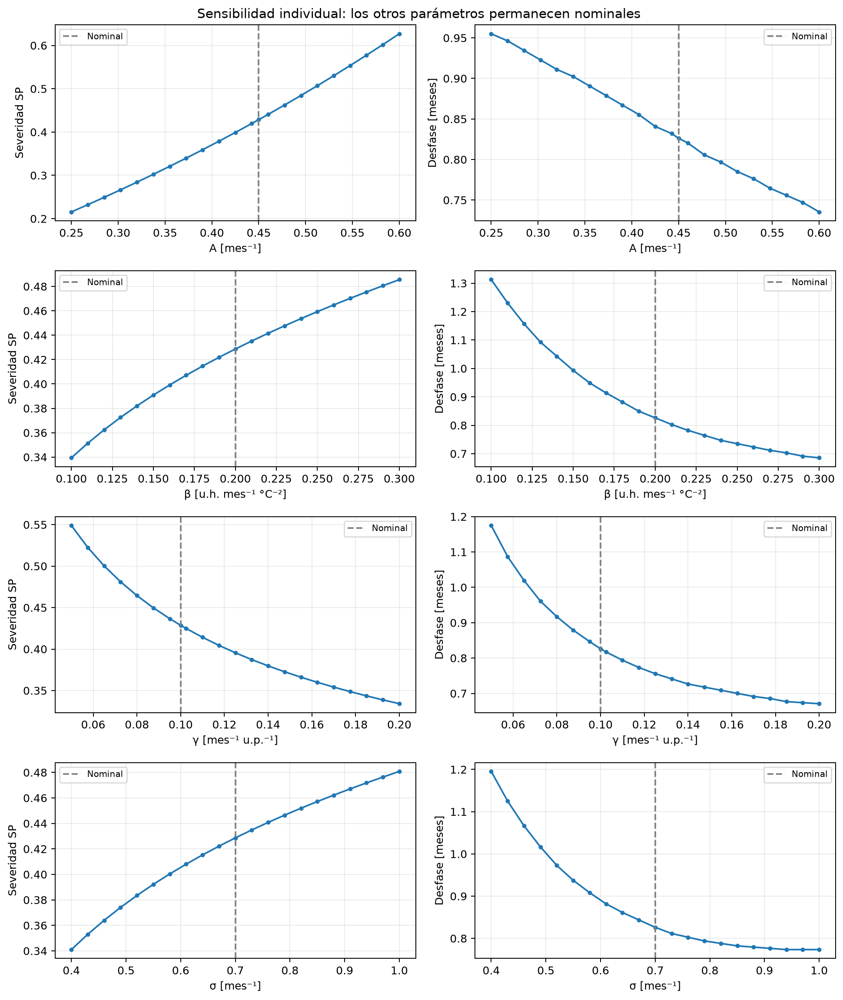
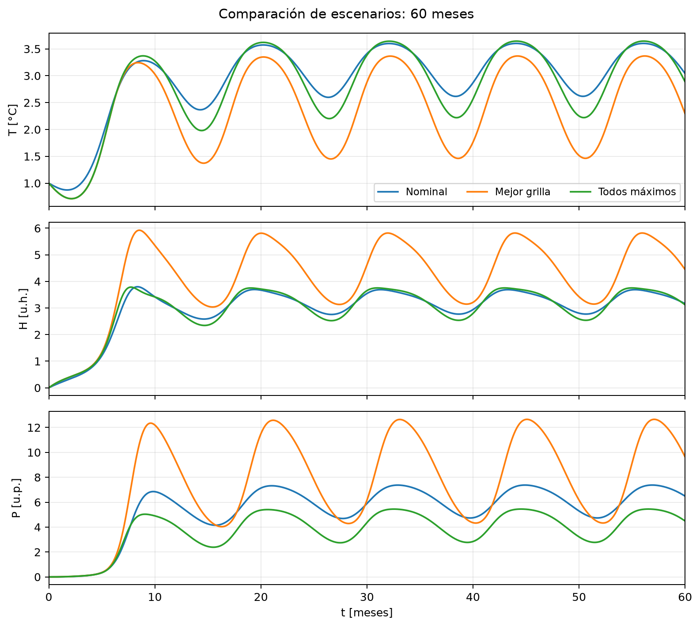
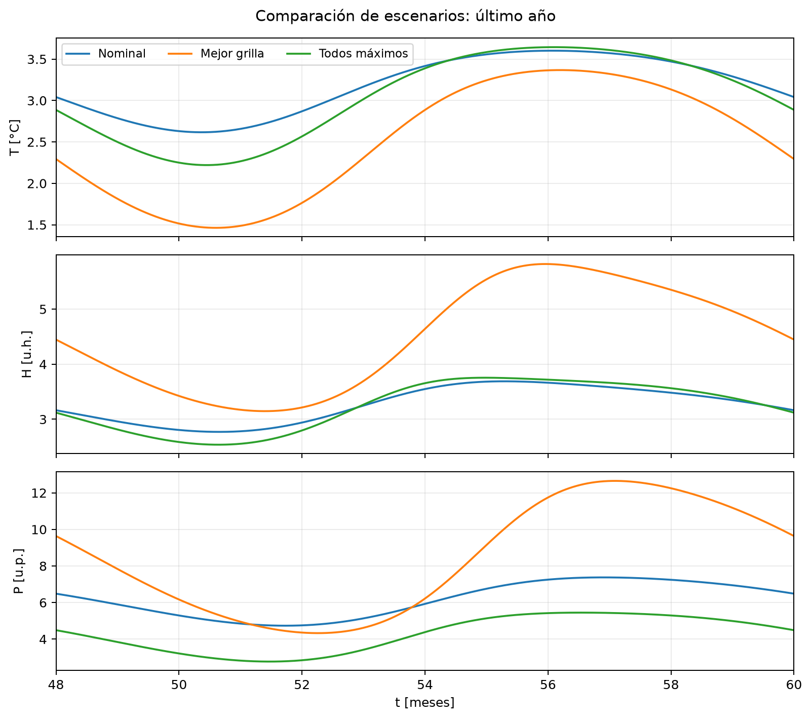
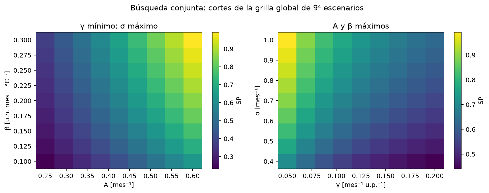

# Resultados del TP

Generados por `python analisis.py`. Las decisiones y convenciones se detallan en [decisiones.md](../decisiones.md).

## Modelo y método

Se integra el sistema no lineal del modelo simplificado de El Niño:

```text
T' = R(t)*T*(1 - T/Tmax) - alpha*H
H' = beta*T² - gamma*H*P
P' = delta*H² - sigma*P
R(t) = Roce + A*cos(omega*t - pi)
```

Tiempo en meses; T en °C, H en u.h. y P en u.p. Condiciones iniciales: (T,H,P)=(1,0,0). Intervalo: [0,60] meses.
Parámetros nominales: Tmax=4; Roce=0.30; alpha=0.05; beta=0.20; gamma=0.10; delta=0.40; sigma=0.70; A=0.45; omega=2*pi/12. Las unidades de los coeficientes se detallan en modelo.py.
Se aplica Euler explícito, y[n+1]=y[n]+h*f(t[n],y[n]), actualizando las tres componentes simultáneamente. Se mantiene el mismo método para las referencias y todos los escenarios.

## Parte 1: convergencia y estabilidad

- Referencia Euler: h = 4.577636719e-05 meses.
- Verificación con tres referencias h, 2h y 4h: orden observado = 1.000025. La diferencia entre referencias es compatible con una estimación de error de primer orden.
- Diferencia máxima de T al refinar la referencia: 2.08784e-05 °C; equivale al 0.195% del menor error analizado (objetivo: <1%).
- Pendiente log-log de las primeras cuatro mallas: 1.00963; compatible con el orden 1 de Euler.

| h [meses] | Error máximo T [°C] | Orden observado | Estado |
|---:|---:|---:|---|
| 0.0234375 | 0.01070049 | — | finita; evaluar estabilidad |
| 0.046875 | 0.02148585 | 1.00571 | finita; evaluar estabilidad |
| 0.09375 | 0.04323525 | 1.00882 | finita; evaluar estabilidad |
| 0.1875 | 0.08735086 | 1.01461 | finita; evaluar estabilidad |
| 0.375 | 0.1772199 | 1.02065 | finita; evaluar estabilidad |
| 0.75 | 0.356907 | 1.01001 | finita; evaluar estabilidad |
| 1.5 | desbordamiento | — | desbordamiento |
| 3 | desbordamiento | — | desbordamiento |
| 6 | 3.054922e+25 | — | trayectoria espuria |
| 12 | 11387.87 | — | trayectoria espuria |

El orden tabulado usa el error de la fila actual dividido por el de la fila anterior y logaritmo en base 2. Solo representa orden de convergencia en el rango de pasos pequeños.

En el barrido auxiliar, el primer paso que produce desbordamiento es h = 1.225 meses. Es un resultado de esa malla de exploración, no un umbral exacto de estabilidad.
Antes del desbordamiento aparecen oscilaciones artificiales en P y una desviación del cociente E/h respecto del régimen fino. El acoplamiento no lineal puede hacer que la pérdida de estabilidad se vea primero en H o P, aunque el error exigido por el enunciado se mida en T. Aumentar el error por usar un paso grande y producir una trayectoria espuria son fenómenos distintos; los gráficos muestran ambos.
En las trayectorias finitas del barrido original de 0.025 meses, E_T/h permanece aproximadamente entre 0.46 y 0.51. Sin embargo, ese muestreo saltea pasos con crecimiento explosivo todavía finito. Se agregó un barrido de resolución 0.0001 meses en [1.15,1.30] para cubrir la transición solicitada en 1(d).
El primer punto de ese barrido fino con E_T/h mayor que diez veces el valor de malla fina es h=1.1860: E_T=4.41784e+49 °C. El factor diez solo identifica una desviación marcada, no define un límite teórico de estabilidad. Se observan tanto trayectorias explosivas finitas como desbordamientos intercalados; no se debe interpolar entre unos y otros para declarar un umbral exacto.
La clasificación a horizonte finito no es monótona ni equivale a estabilidad asintótica. Al refinar el muestreo del paso cambió la evidencia de la transición, no las ecuaciones ni los resultados de las mallas finas.
Para interpretar las oscilaciones también se linealiza localmente: e[n+1] ≈ (I+h*J)e[n], con J=df/dy. Para un autovalor disipativo lambda, Euler requiere |1+h*lambda|≤1 en el problema lineal congelado; esto da h≤-2*Re(lambda)/|lambda|².
Al muestrear el último año nominal, el menor límite local de los modos disipativos es 0.842211 meses. Esto ayuda a explicar las oscilaciones observadas para pasos del orden de un mes. El sistema es no autónomo y no lineal: este diagnóstico local no es una prueba de estabilidad global ni predice exactamente el primer desbordamiento.
Los pasos 6 y 12 producen trayectorias explosivas pero terminan con números finitos porque realizan muy pocas iteraciones. No son una recuperación de estabilidad. Se excluyen del gráfico log-log para que su escala no oculte la convergencia, y no se interpreta un orden para ellos.







## Parte 2: paso e indicadores

Paso adoptado: h = 0.0029296875 meses. En todas las combinaciones exploradas y los barridos individuales, la última comparación h frente a 2h da una diferencia relativa máxima de SP de 0.1305% y una diferencia máxima de desfase de 0.00878906 meses. Son estimaciones por refinamiento, no cotas rigurosas del error.
Se verifica también Pmax, Pmin y Pmed: su mayor diferencia relativa es 0.0412% (tolerancia adoptada: 0.5%). Para el caso nominal, la diferencia máxima de T entre el paso adoptado h=0.0029296875 y la referencia Euler de la Parte 1 es 0.00131582 °C. El paso está por debajo de todas las mallas del rango convergente estudiado.

Los indicadores usan únicamente [48,60]. El promedio es temporal por trapecios. Los picos se detectan en los nodos, de modo que el desfase tiene la resolución del paso.

| Escenario | A | beta | gamma | sigma | SP | Desfase [meses] | Pmax | Pmin | Pmed | Residuo anual |
|---|---:|---:|---:|---:|---:|---:|---:|---:|---:|---:|
| Nominal | 0.45 | 0.2 | 0.1 | 0.7 | 0.428658 | 0.826172 | 7.37594 | 4.73548 | 6.15985 | 0.000405214 |
| Mejor grilla | 0.6 | 0.3 | 0.05 | 1 | 0.99127 | 0.893555 | 12.6525 | 4.32894 | 8.3969 | 0.000545847 |
| Todos máximos | 0.6 | 0.3 | 0.2 | 1 | 0.626015 | 0.439453 | 5.44969 | 2.77331 | 4.27527 | 0.000367947 |

Pmax, Pmin y Pmed se expresan en u.p.; SP y los residuos son adimensionales.





## Sensibilidad individual

| Parámetro | SP en extremo inferior → superior | Desfase inferior → superior [meses] |
|---|---:|---:|
| A | 0.215492 → 0.626963 | 0.955078 → 0.735352 |
| beta | 0.339406 → 0.485561 | 1.3125 → 0.685547 |
| gamma | 0.54895 → 0.334136 | 1.1748 → 0.670898 |
| sigma | 0.341011 → 0.480803 | 1.19531 → 0.773438 |

En los puntos muestreados, SP aumenta con A, beta y sigma, y disminuye con gamma. El desfase no aumenta al incrementar ninguno de los cuatro parámetros; algunos valores consecutivos coinciden por la resolución temporal de los picos. Estas tendencias se refieren a los intervalos indicados y al resto de parámetros nominales.

- **A:** aumenta el contraste estacional de R(t), sin cambiar su media anual. En los experimentos aumenta SP y disminuye el desfase: la excitación térmica más intensa se propaga a H y P a través de sus fuentes cuadráticas.
- **beta:** aumenta la fuente de humedad beta*T². En este rango aumenta SP y reduce el desfase, aunque también refuerza el enfriamiento indirecto de T a través de H. El resultado surge del sistema acoplado, no solo del signo positivo de beta.
- **gamma:** aumenta el consumo de humedad gamma*H*P. Reduce la humedad disponible para la fuente delta*H². Se observa una menor severidad relativa y un desfase menor; el consumo atenúa el ciclo y acelera el ajuste de humedad cuando P es positiva.
- **sigma:** aumenta la descarga de P y reduce su escala de disipación 1/sigma. En este rango disminuye el desfase y aumenta SP: una disipación más rápida reduce el almacenamiento y permite mayor contraste relativo entre máximo y mínimo. Esto no implica que aumente la precipitación absoluta.



## Búsqueda conjunta y comparación

Se evaluaron 7170 combinaciones distintas entre la grilla inicial de 5⁴ puntos, una grilla global de 9⁴ puntos y el refinamiento local de 5⁴ puntos. Se eliminan los puntos repetidos. 7170 cumplen el criterio operativo de admisibilidad. El mayor residuo anual de la grilla fue 0.00110776; el umbral adoptado es 0.01.
El residuo compara cada variable del penúltimo y último ciclo a igual fase y normaliza por su máxima magnitud en el último ciclo. La comparación indica repetición anual aproximada al final de los 60 meses; no demuestra periodicidad exacta ni acotación para todo tiempo futuro.

La mejor combinación hallada no toma todos los parámetros en su máximo: gamma queda en el mínimo. Esto es coherente con que gamma consume humedad, mientras beta la genera. A y sigma intervienen en otros términos, y SP mide amplitud relativa, por lo que maximizar los cuatro coeficientes no equivale a maximizar SP.
La severidad del mejor escenario es 2.312 veces la nominal. El escenario de todos los máximos tiene SP = 0.626015.
El resultado es el mejor escenario encontrado en las grillas examinadas. No constituye una prueba de máximo global continuo. El refinamiento en h y el refinamiento paramétrico resuelven incertidumbres distintas.





## Verificación adicional de los escenarios finales

Se recalculan los diez mejores candidatos con h, h/2 y h/4. La misma combinación gana en los tres pasos. Es una comprobación de robustez del ranking entre finalistas; no reemplaza la limitación de la búsqueda por grilla.
También se comparan las trayectorias completas [0,60] de los tres escenarios de la tabla, variable por variable y en nodos comunes. Se exige un cambio menor al 0.5% de la máxima magnitud de cada variable. Los extremos de toda la simulación se guardan para documentar acotación observada, en vez de apoyarse únicamente en la guarda de 10^6.

| Escenario | Paso [meses] | SP | Desfase [meses] |
|---|---:|---:|---:|
| mejor_grilla | 0.0029296875 | 0.99127002 | 0.89355469 |
| nominal | 0.0029296875 | 0.42865755 | 0.82617188 |
| todos_maximos | 0.0029296875 | 0.62601504 | 0.43945312 |
| mejor_grilla | 0.00146484375 | 0.99091641 | 0.89355469 |
| nominal | 0.00146484375 | 0.42852155 | 0.82763672 |
| todos_maximos | 0.00146484375 | 0.62594419 | 0.43945312 |
| mejor_grilla | 0.000732421875 | 0.99073981 | 0.89355469 |
| nominal | 0.000732421875 | 0.42845359 | 0.82763672 |
| todos_maximos | 0.000732421875 | 0.62590871 | 0.43945312 |

La tabla principal conserva el paso común utilizado para todos los escenarios; esta tabla muestra su incertidumbre por refinamiento adicional. No se mezclan pasos al comparar los casos.

### Refinamiento paramétrico en todo el dominio

El refinamiento global verifica regiones interiores que una búsqueda solo local podría pasar por alto. Todas las resoluciones se comparan al mismo paso temporal:

| Grilla | Puntos | Mejor SP | A | beta | gamma | sigma |
|---|---:|---:|---:|---:|---:|---:|
| inicial_5 | 625 | 0.99127 | 0.6 | 0.3 | 0.05 | 1 |
| global_9 | 6561 | 0.99127 | 0.6 | 0.3 | 0.05 | 1 |
| local_5 | 625 | 0.99127 | 0.6 | 0.3 | 0.05 | 1 |

También se comparan vecinos de la grilla global en cada dirección, manteniendo fijos los otros tres parámetros. Se registra cuántas comparaciones invierten el signo observado en los barridos individuales:

| Parámetro | Signo ensayado de variación de SP | Comparaciones | Inversiones |
|---|---:|---:|---:|
| A | +1 | 5832 | 0 |
| beta | +1 | 5832 | 0 |
| gamma | -1 | 5832 | 0 |
| sigma | +1 | 5832 | 0 |

No se detectan inversiones en esta grilla: SP aumenta con A, beta y sigma y disminuye con gamma en las comparaciones conjuntas muestreadas. Esto respalda la esquina encontrada como máximo de la grilla global; no demuestra monotonicidad entre nodos ni un máximo global continuo.

Los mapas siguientes son cortes con los otros dos parámetros fijos según sus títulos; no son proyecciones ni una representación completa de las cuatro dimensiones.



## Archivos de datos

Los CSV conservan los valores sin redondear del análisis: convergencia, estabilidad, verificación del paso, sensibilidad, grilla, comparación y trayectorias de los tres escenarios. Los parámetros no barridos mantienen sus valores nominales. No se utilizaron datos climáticos observacionales.
